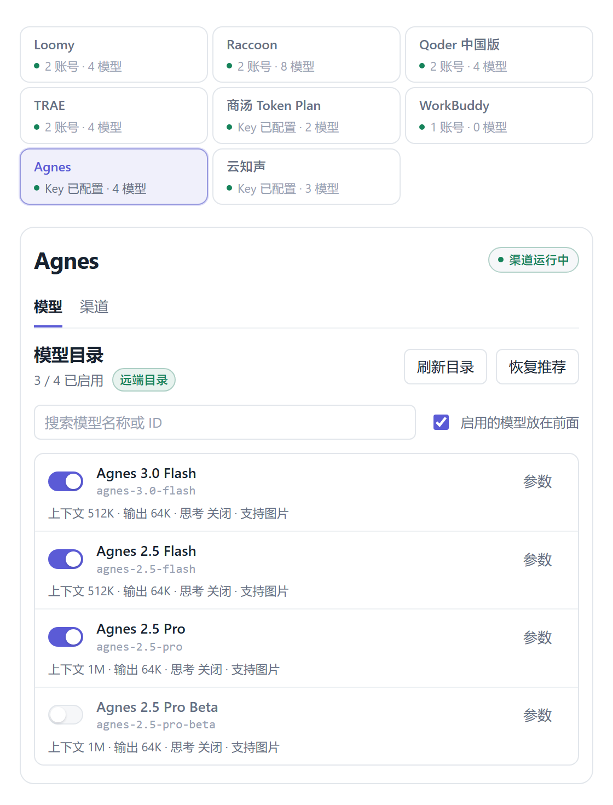
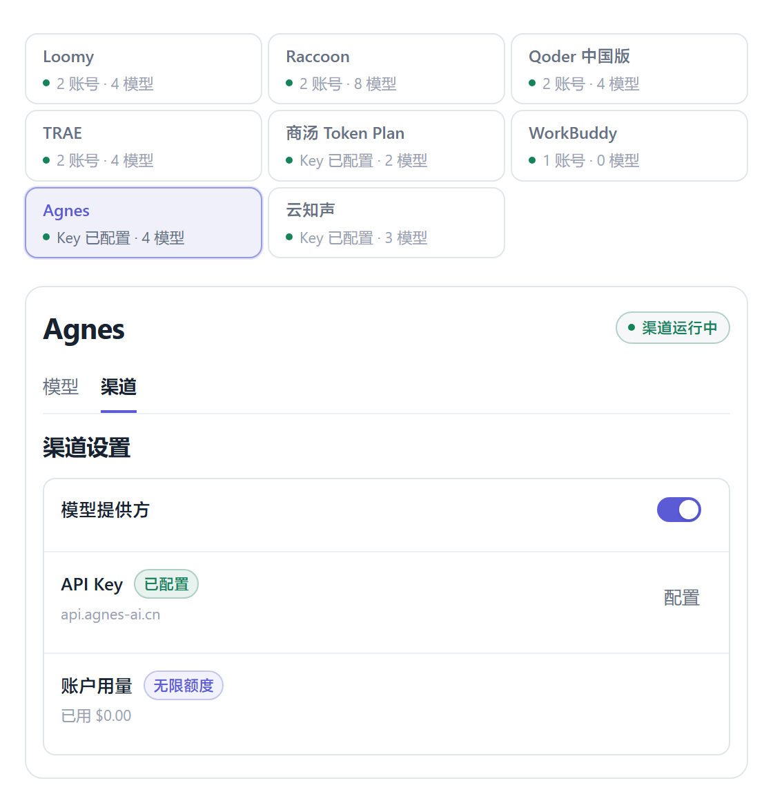

<div align="center">

# Unified Router

**十二个国内渠道的模型、账号与额度，收在同一个设置页里。**

[](#来源与许可证)
[](#兼容性)
[](#兼容性)

[快速开始](#快速开始) · [支持清单](#支持清单) · [安装](#安装) · [配置](#配置) · [文档](#文档)

<picture>
  <source media="(prefers-color-scheme: dark)" srcset="https://raw.githubusercontent.com/KouzakiUmi/dsh-unified-router/main/assets/preview/overview-dark.png">
  
</picture>
<picture>
  <source media="(prefers-color-scheme: dark)" srcset="https://raw.githubusercontent.com/KouzakiUmi/dsh-unified-router/main/assets/preview/channel-dark.png">
  
</picture>

<sub>真实组件 · 虚构数据 · 离线渲染，由 <code>scripts/render-preview.mjs</code> 生成</sub>

</div>

## 快速开始

```console
dsh plugin --profile <profile> add <路径>
```

`<profile>` 是目标 Profile，请替换为实际值。**Desktop 使用桌面壳自带的 DSH Desktop CLI**，不要从独立公共 CLI 管理保留的 `desktop` Profile。

1. **重载插件**：让 Host 与 Client 一起生效。只刷新页面不保证宿主侧代码已升级。
2. **打开设置页**：进入 **设置 → 能力 → Unified Router**，在渠道卡片网格里选择要配置的渠道。
3. **账号池渠道**（Raccoon、Qoder 中国版、TRAE）：点「添加账号」准备授权地址，再点「打开登录页面」链接，在浏览器完成授权后回到设置页点「检查登录」，列表自动刷新，不需要再手动刷新。[凭据怎么拿](https://github.com/KouzakiUmi/dsh-unified-router/blob/main/docs/credentials.md)
4. **自管账号渠道**（WorkBuddy、AStudio、CodeArts）：点「添加账号」，按渠道选择浏览器登录、扫码、本机导入或粘贴凭据。
5. **API Key 渠道**（商汤 Token Plan、Agnes、云知声、千帆 Token Plan、阿里云百炼、Step Plan）：进入该渠道的「渠道」分区，在 API Key 输入框填入 Key 并保存。保存 Key 时，若模型提供方仍是关闭状态，插件会顺手把它启用。
6. **核对结果**：打开「模型」分区查看上游目录与模型开关，打开「账号与额度」查看订阅类型、剩余额度与更新时间。

## 功能

- **统一设置页**：账号池渠道与自管账号渠道用「模型」「账号与额度」「渠道」，API Key 渠道用「模型」「渠道」。各渠道的账号、模型与设置使用同一套操作入口。
- **账号池渠道的多账号轮换与每日签到**：Raccoon、Qoder 中国版、TRAE 各自使用账号池，多账号按顺序轮换，提供方开关、额度与模型目录分渠道管理。Qoder 中国版、TRAE、WorkBuddy、AStudio、CodeArts、Raccoon 支持每日签到，自动签到与手动签到共用同一份记录。
- **账号订阅类型**：账号行与额度药丸展示每个账号的订阅类型（TRAE 的 `Free` / `Pro` / `Pro+` / `Ultra` / `Express`，WorkBuddy 与自管渠道的上游套餐文案，Raccoon 的体验版/订阅）。无数据源的渠道不显示，不编造。
- **付费专用模型标注**：仅付费订阅可用的模型挂「订阅限定」徽标，与倍率/免费徽标并存。TRAE 的 Qwen4、GLM-5.4、Kimi-K3.1 系列已核实为付费专用。
- **小浣熊统一免费与订阅模型**：渠道分区提供开关。开启后免费与订阅模型合并为一组，同名模型只出现一次，优先使用免费账号，免费额度用尽自动改用订阅账号；关闭时两组独立。
- **智能选号与默认输出上限**：渠道分区可切换手动顺序、免费额度优先、临期额度优先、缓存优先四种选号方式，并为每个渠道设定缺规格模型的默认输出上限（默认 / 64K / 128K / 256K）。
- **API Key 渠道的 Key 管理、模型目录、思考档位与参数**：六家 API Key 渠道共用一套实现，设置页填 Key、开关模型、调整上下文与最大输出等参数，并按上游支持的档位配置思考深度。
- **图像生成与编辑**：Agnes、商汤 Token Plan 与阿里云百炼可在「渠道」分区打开图像工具。生成和编辑结果会作为对话图片，可继续用作参考；`image_read` 工具把参考图句柄印进结果，供改图使用。
- **模型启停与「恢复推荐」**：模型目录只认上游，本地开关只做显隐标记。模型分区提供「刷新目录」「恢复推荐」，「恢复推荐」清除本地开关覆盖，按[设计规范 §3](https://github.com/KouzakiUmi/dsh-unified-router/blob/main/docs/DESIGN-STANDARDS.md#3-模型目录与命名)重置推荐列表。
- **首屏恢复与后台静默刷新**：打开设置页先恢复上次查看的渠道与最近一次结果，页面可见时每 5 秒读取一次宿主快照，页头「刷新」触发后台采集，界面随下一次快照读取更新。
- **凭据与上游原文不进界面**：账号与额度快照走公开字段投影，凭据只以引用名保存，上游响应原文不回显；退出或移除账号需二次确认。

## 支持清单

顶部 **Agent** 组与 **API** 组各六张卡片。

| 渠道 | 类型 | 登录或鉴权方式 | 额度或用量 | 签到 | 模型目录来源 |
|---|---|---|---|---|---|
| Raccoon（小浣熊） | 账号池 | 浏览器授权登录（登录后按套餐分流） | 账号积分与额度包 | 每日积分由上游发放 | 上游 `GET /api/web/llm/v2/model_catalog`，免费面与订阅面各用本侧账号凭据 |
| Qoder 中国版 | 账号池 | 浏览器授权登录（HTTPS 授权页）；拉目录需本机官方 CLI 登录 | 账号积分 | 有（每日 10:00 UTC+8 进入新周期） | 官方 CLI `qoderclicn --list-models`；CLI 不可用时回落策展表 |
| TRAE | 账号池 | 浏览器 OAuth 登录（本机回调） | 积分与余额；订阅类型读自付费状态接口 | 有 | 上游 `POST /api/ide/v1/batch_get_detail_param`（`solo_agent` 通道） |
| WorkBuddy | 自管账号 | 官方浏览器授权（主机轮询授权结果，最长约 5 分钟） | 套餐与积分窗口（Credits / Extra credits） | 有 | 上游 `GET /v3/config` 的 `agents[cli].models` |
| AStudio | 自管账号 | 本机导入、扫码登录或粘贴凭据 | 会员与积分 | 有 | 上游模型目录 |
| CodeArts | 自管账号 | 本机导入、浏览器授权或粘贴凭据 | 用量与免费日池 | 有 | 上游内置模型与免费权益目录 |
| 商汤 Token Plan | API Key | 渠道页填 API Key；控制台额度用浏览器授权 | 配置控制台令牌后显示积分池、5 小时 / 7 天窗口与赠送额度 | 无 | 上游 `GET /v1/models`（`token.sensenova.cn`） |
| Agnes | API Key | 渠道页填 API Key | New API 账单接口（`hard_limit_usd` / `total_usage`），实测返回无限额度 | 无 | 上游 `GET /v1/models` |
| 云知声 | API Key | 渠道页填 API Key；控制台会话读 U Plan 额度 | U Plan 积分和窗口重置倒计时 | 无 | 上游 `GET /anthropic/v1/models`（Anthropic 兼容模型列表） |
| 千帆 Token Plan | API Key | 渠道页填 API Key；控制台会话读额度 | 控制台按月度积分 / Token 制展示 | 无 | 上游 `GET /v2/tokenplan/personal/models`（OpenAI 兼容） |
| 阿里云百炼 | API Key | 渠道页填 API Key；控制台会话读额度 | 5 小时 / 周 / 月度百分比窗口 | 无 | 上游 `GET /compatible-mode/v1/models`（OpenAI 兼容） |
| Step Plan | API Key | 渠道页填 API Key；控制台会话读额度 | 周 / 月度百分比窗口 | 无 | 上游 `GET /step_plan/v1/models`（OpenAI 兼容） |

只做 CN 版：WorkBuddy AI、Trae Global、Qoder 国际版、Step Plan 海外版不接入。各渠道的目录来源、思考档位方言、模型参数与限制见 [提供商清单](https://github.com/KouzakiUmi/dsh-unified-router/blob/main/docs/providers.md)。

## 安装

**目录直装**（把目录长期保留在 `$DSH_HOME/dsh-go/plugins/` 下）：

```sh
dsh plugin --profile <profile> add <路径>
```

**GitHub Release 压缩包**：在仓库 [Releases](https://github.com/KouzakiUmi/dsh-unified-router/releases) 页下载资产 `dsh-unified-router.tgz`（配套 `dsh-unified-router.tgz.sha256`），用下载后的本地路径安装：

```sh
dsh plugin --profile <profile> add <解压后的路径>
```

新装后会被引擎加载。若替换了已加载的宿主代码，应在插件详情里重新载入该插件；客户端界面需重新打开设置页或刷新网页。无需重新构建 APK，无需替代 Web 服务器。

**卸载**：

```sh
dsh plugin --profile <profile> remove dsh-unified-router
```

卸载只移除插件，原账号数据保留。**Desktop 请使用桌面壳自带的 DSH Desktop CLI**。

### 后端模式

后端模式在安装配置中选择。

- **`shared`（共用）**：复用同宿主中已在运行的 channel-pack 兼容插件的账号池。Web API 只操作本插件接入的 channel-pack 渠道，不重复启动适配器，不另开账号数据库；账号池签到由原后端调度，Unified Router 调度 WorkBuddy。
- **`standalone`（独立）**：本包独立后端注册 `raccoon` / `raccoon-pro` / `qodercn` / `trae` 四个 channel-pack 提供方，商汤 Token Plan 由内置控制器管理，WorkBuddy、AStudio、CodeArts 与 API Key 渠道由各自的独立控制器管理。检测到原账号池仍在运行时会拒绝启动，避免两个实例覆盖同一状态。

## 配置

**设置页路径**：**设置 → 能力 → Unified Router**。渠道选择器是自动换行的小卡片网格，打开设置页会进入上次查看的渠道。

**各渠道怎么配**：每个渠道的凭据获取位置、设置页填写位置与凭据引用名见 [凭据获取指引](https://github.com/KouzakiUmi/dsh-unified-router/blob/main/docs/credentials.md)；各渠道的目录、档位、参数与额度语义见 [提供商清单](https://github.com/KouzakiUmi/dsh-unified-router/blob/main/docs/providers.md)。

**自动签到开关**：宿主配置项 `autoCheckin: false` 关闭 Unified Router 的自动签到，手动签到仍使用同一份记录。独立模式下，自动签到包含 Raccoon、Qoder 中国版、TRAE、WorkBuddy、AStudio 和 CodeArts；账号行显示「已签到」「签到失败」「签到待确认」等实际状态。

**状态与凭据的存放**：

- 凭据经宿主 `credentials` 服务存取，引用名为 `UNIFIED_ROUTER_*`（如 `UNIFIED_ROUTER_AGNES_API_KEY`、`UNIFIED_ROUTER_UNISOUND_API_KEY`、`UNIFIED_ROUTER_SENSENOVA_API_KEY`、`UNIFIED_ROUTER_WORKBUDDY_ACCOUNTS`）。Key 不进入任何返回值、日志与错误文案。
- 最近一次的账号、额度与状态投影以公开字段原子写入 profile 状态目录的 `dsh-unified-router/settings.json`，部分失败时保留对应账号上一次成功的额度与更新时间。
- 商汤渠道的状态目录与凭据命名空间为 `dsh-unified-router-sensenova`。
- 浏览器 `localStorage` 用于跨次渲染与记忆上次查看的渠道。

## 兼容性

| 项 | 要求 |
|---|---|
| Node.js | `>=22.19.0` |
| DSH Core（`engines.dsh`） | `>=0.2.1-rc.2 <0.3.0-0` |
| `@deepseek-ai/cordis` | `>=0.2.0-rc.1 <0.2.1-0 \|\| >=0.2.1-0 <0.2.2-0 \|\| >=0.2.2-0 <0.3.0-0` |
| `@deepseek-ai/dsh-credentials` | `>=0.2.0-rc.1 <0.2.1-0 \|\| >=0.2.1-0 <0.2.2-0 \|\| >=0.2.2-0 <0.3.0-0` |
| `@deepseek-ai/dsh-llm` | `>=0.2.0-rc.1 <0.2.1-0 \|\| >=0.2.1-0 <0.2.2-0 \|\| >=0.2.2-0 <0.3.0-0` |
| `@deepseek-ai/dsh-llm-pi-ai` | `>=0.1.5 <0.3` |
| `@deepseek-ai/schemastery` | `>=0.2.0-rc.1 <0.2.1-0 \|\| >=0.2.1-0 <0.2.2-0 \|\| >=0.2.2-0 <0.3.0-0` |
| `@earendil-works/pi-ai` | `>=0.85.0 <2.0.0` |

`package.json` 的 `dsh` 字段声明：`manifestVersion` 为 1，带 `cordis.patch.yml` 的 bundle 补丁；客户端平台为 `web`，注入 `@deepseek-ai/dsh-client-connection`、`@deepseek-ai/dsh-client-ui-settings` 与 `@deepseek-ai/dsh-client-ui-slots`。插件通过 `settings.section` 挂载设置页，不新增聊天、侧栏或原生设置胶囊入口。

## 文档

| 文档 | 内容 |
|---|---|
| [设计规范](https://github.com/KouzakiUmi/dsh-unified-router/blob/main/docs/DESIGN-STANDARDS.md) | 设置页信息架构、数据加载、模型目录与命名、文案与视觉的完整规则 |
| [渠道接入架构](https://github.com/KouzakiUmi/dsh-unified-router/blob/main/docs/CHANNEL-ARCHITECTURE.md) | 声明式规格、统一契约与持久化中间层 |
| [API Key 渠道契约](https://github.com/KouzakiUmi/dsh-unified-router/blob/main/docs/APIKEY-CHANNELS.md) | 商汤、Agnes、云知声、千帆、百炼、Step Plan 的接口契约、实测与官方文档事实、管理器与 RPC 投影 |
| [自管多账号渠道契约](https://github.com/KouzakiUmi/dsh-unified-router/blob/main/docs/MANAGED-CHANNELS.md) | WorkBuddy、AStudio、CodeArts 的多账号框架与实测边界 |
| [提供商清单](https://github.com/KouzakiUmi/dsh-unified-router/blob/main/docs/providers.md) | 各渠道的目录来源、思考档位方言、模型参数、额度 / 用量与限制 |
| [凭据获取指引](https://github.com/KouzakiUmi/dsh-unified-router/blob/main/docs/credentials.md) | 各渠道凭据的获取位置、设置页填写位置与引用名 |
| [架构](https://github.com/KouzakiUmi/dsh-unified-router/blob/main/docs/architecture.md) | 模块分层、RPC 与数据流 |
| [开发说明](https://github.com/KouzakiUmi/dsh-unified-router/blob/main/docs/development.md) | 构建、测试与验证约定 |
| [发布说明](https://github.com/KouzakiUmi/dsh-unified-router/blob/main/docs/publish.md) | 打包与发布流程 |
| [更新记录](https://github.com/KouzakiUmi/dsh-unified-router/blob/main/docs/changelog.md) | 版本变更记录 |
| [目录审计](https://github.com/KouzakiUmi/dsh-unified-router/blob/main/docs/CATALOG-AUDIT.md) | 硬编码目录与上游真实目录的逐条核对记录 |
| [Qoder CLI 接入](https://github.com/KouzakiUmi/dsh-unified-router/blob/main/docs/QODER-CLI.md) | Qoder 中国版借官方 CLI 拉目录的方案、降级链与风险 |
| [图像能力](https://github.com/KouzakiUmi/dsh-unified-router/blob/main/docs/IMAGE-CAPABILITIES.md) | 读图句柄、聊天模型图片输入与生图/编辑工具 |
| [模型规格](https://github.com/KouzakiUmi/dsh-unified-router/blob/main/docs/MODEL-SPECS.md) | 官方模型规格与参数档位表 |
| [目录策展原则](https://github.com/KouzakiUmi/dsh-unified-router/blob/main/MODEL-CURATION.md) | 模型目录来源与展示原则 |

## 来源与许可证

MIT，见 [`package.json`](package.json) 的 `license` 字段。

本仓库包含来自第三方 MIT 项目的 vendored 实现（channel-pack 账号池、商汤 Token Plan 认证与适配器、WorkBuddy 登录与用量原语等）。完整第三方组件、上游来源、版本与许可证清单见 [NOTICE.md](https://github.com/KouzakiUmi/dsh-unified-router/blob/main/NOTICE.md) 及 `vendor/*/NOTICE.md`、`vendor/*/THIRD_PARTY_NOTICES.md`。
