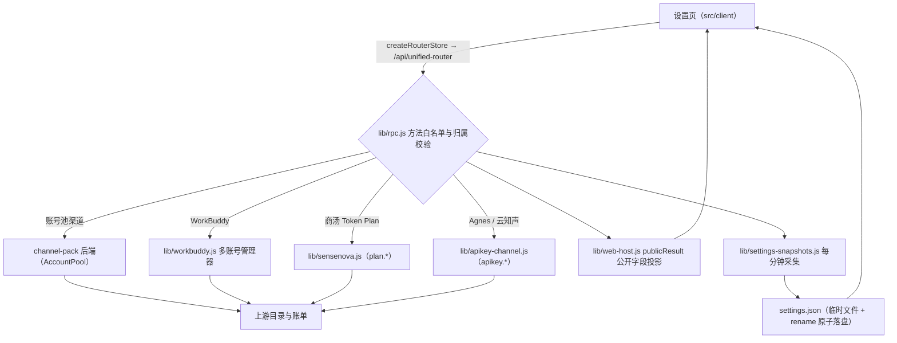

# 架构总览

> 面向贡献者与维护者：整体分层、数据通路与已定的设计结论。界面与交互规则见 [DESIGN-STANDARDS.md](DESIGN-STANDARDS.md)，API Key 渠道契约见 [APIKEY-CHANNELS.md](APIKEY-CHANNELS.md)，目录与上游差异见 [CATALOG-AUDIT.md](CATALOG-AUDIT.md)，逐版本变更见 [changelog.md](changelog.md)，开发与验证见 [development.md](development.md)。

## 定位一句话

**统一的 CN 渠道设置页与账号、额度、模型管理层**：八个国内渠道共用一套设置页和一套账号/模型管理逻辑。账号池渠道复用 channel-pack 的账号池与选号，WorkBuddy 走自管多账号管理器，API Key 渠道走共用管理器，三者都经宿主侧同一个 RPC 服务和设置快照对设置页暴露。插件只注册设置页，不注册聊天、侧栏或原生设置胶囊入口。

## 数据流



设置页不直接访问上游。所有读数先经宿主 RPC，再由 `publicResult` 做公开字段投影，凭据引用与上游响应原文不进入浏览器。会改变凭据或注册状态的写操作（商汤与 API Key 渠道的写方法、WorkBuddy 的写方法、`settings.refresh`、`credits.claimAll`）在 RPC 层额外受同源与主机授权门禁。

## 目录地图

| 目录 | 职责 |
|---|---|
| `src/client/` | 设置页源码。`core.js` 共享常量与归一化，`store.js` 是 `createRouterStore`（RPC、状态、请求生命周期与写操作），`styles.js` 提供 `--eac-*` 设计令牌与样式，`ui.js` 是 UI 原语，`kit/index.js` 是唯一允许拼 JSX 的组件层，`panels-core.js` 渲染账号/模型/渠道分区，`settings.js` 是根组件与 `settings.section` 注册，`providers/*.js` 提供各渠道的视图数据、能力与动作 |
| `src/backend/providers/` | 独立推理后端的渠道挂载模块：`context.ts` 定义 `ProviderContext`，`loomy.ts`、`raccoon.ts`、`qodercn.ts`、`trae.ts` 各自返回适配器与账号维护函数 |
| `src/backend.ts` | 独立后端入口 `mountBackend`：装配账号池、注入模型参数、包装图片偏好与模型选择器、注册渠道 RPC、启动后台维护定时器 |
| `lib/` | 手维护宿主模块与构建产物。`web-host.js`（RPC 接口与公开投影）、`rpc.js`（方法白名单与路由守卫）、`settings-snapshots.js`、`settings-providers.js`、`sensenova.js`、`workbuddy.js`、`apikey-channel.js`、`apikey-llm.js`、`apikey-models.js`、`apikey-providers.js`、`catalog-cache.js`、`model-catalog.js`、`daily-checkin.js`、`sensenova-params.js`；`client.js`、`backend.js`、`qoder-auth-wasm.wasm` 由构建生成 |
| `vendor/` | 内置的第三方 MIT 实现。`channel-pack/src/`（账号池、各渠道适配器与 RPC、目录与签到、Qoder CLI），`sensenova-token-plan/`（商汤认证、用量与适配器核心），`workbuddy/`（登录与用量原语） |
| `scripts/` | `build.mjs` 构建后端、复制 WASM、拼接客户端并做语法自检；`migrate-from-magpie.mjs` 是一次性凭据迁移脚本（默认 dry-run） |
| `test/` | 离线回归用例 `*.test.mjs` 与宿主契约桩 `kernel.mjs` |
| `docs/` | 设计规范、渠道契约、目录审计、交接记录与本文档集 |

## 客户端模块拼接机制

浏览器端的 ModuleLoader 只接受一个工厂文件，因此客户端源码按依赖顺序拼接为 `lib/client.js`。

- 源码位于 `src/client/`，模块之间**不写 `import`**：拼接后共享同一个工厂作用域，跨模块标识符直接按名引用。
- 顺序表是 `scripts/build.mjs` 的 `clientModules`，顺序即依赖顺序（`core.js` 最先，`settings.js` 最后），新模块必须登记进该表。
- 构建时逐模块剥掉行首 `export ` 前缀后拼接，产物用 `window.__ModuleLoader__.load` 注册，工厂返回 `{ name: 'dsh-unified-router', inject: ['slots', 'connection'], apply, createRouterStore, safeLoginUrl, filterModels, claimMessage }`。
- **构建期语法自检**有两道：行首 `export ` 前缀的数量必须等于行首 `export const/function/class` 的数量（模板字符串或注释里出现行首 `export` 会在构建期报错）；拼接结果再经 `new vm.Script(...)` 做一次语法校验，顺序或剥离错误不会拖到测试或加载时才暴露。
- 工作区分区是**普通函数直接调用**，不是 `h(Panel, props)` 元素；分区自身不持有 Hook，状态与动作由 `Settings` 注入。

## 宿主侧 RPC：`/api/unified-router`

`lib/web-host.js` 在 `host.connection.fetch` 上注册 `POST /api/unified-router`。请求信封是 `{ type: 'client-request', rpcId, method: 'unified-router', payload: { method, payload } }`，响应为 `{ type: 'server-response', rpcId, result }`。接口拒绝非 POST（405）、非 `application/json`（415）、超大请求体（413，`content-length` 与实际字节数双重检查）与非法 JSON（400）。

**方法白名单**（`lib/rpc.js`）分四组：

| 组 | 方法 |
|---|---|
| 账号池渠道 | `provider.status`、`provider.setEnabled`、`account.list`、`account.create`、`account.update`、`account.delete`、`account.reorder`、`account.refresh`、`account.retest`、`account.reset`、`login.poll`、`model.list`、`model.refresh`、`model.setDisabled`、`model.clearDead`、`model.setAllDisabled`、`model.resetDefaults`、`model.params`、`model.setParams`、`credits.balances`、`credits.claimAll`、`credits.permanentLock`、`onboarding.status`、`onboarding.claim` |
| 商汤 Token Plan | `plan.snapshot`、`plan.setKey`、`plan.setEnabled`、`plan.setModelEnabled`、`plan.setModelParams`、`plan.resetModels` |
| WorkBuddy | `workbuddy.snapshot`、`workbuddy.login`、`workbuddy.logout`、`workbuddy.checkin`、`workbuddy.models` 及模型写方法 |
| API Key 渠道 | `apikey.snapshot`、`apikey.setKey`、`apikey.setEnabled`、`apikey.setModelEnabled`、`apikey.setModelParams`、`apikey.resetModels` |

`guardedRpc` 在转发前做归属校验：`provider.status` 要求 `payload.providers` 全部在白名单；`plan.*` 只认 `sensenova-token-plan`；`workbuddy.*` 只认 `workbuddy`；`apikey.*` 只认 `APIKEY_PROVIDER_IDS`；其余要求 `payload.provider` 在 `PROVIDERS`。带 `accountId` 的账号方法先经 `account.list` 核对归属（`login.poll` 与 `workbuddy.*` 豁免，因为 WorkBuddy 的账号不在账号池里）。

**公开字段投影**由 `publicResult(method, value)` 完成：每个方法只放行白名单字段，凭据引用、上游错误原文、内部字段名一律过滤。`account.list` 的 `plan` 只接受 `free` / `pro` / `unknown` 枚举；模型行的倍率只经 `rate`/`rateBadge` 投影，`name` 不带倍率。

**写操作门禁**：写方法集合是 `plan.*` 写方法、`workbuddy.*` 写方法（`workbuddy.snapshot` 因续期会落盘新凭据，一并按写操作处理）、`apikey.*` 写方法、`settings.refresh`、`credits.claimAll`。这些方法要求请求同源（`Origin` 与 `Host` 一致，`Origin: null` 拒绝），且通过 `host.connection.requestRejection` 的主机授权检查。

**后端就绪等待**：独立后端是 `import('./backend.js')` + `mountBackend()` 的异步挂载，设置页通常先挂载完成。`dispatch` 在渠道后端为空时 `await Promise.race([ready, 15s])` 再转发，超时后才抛「渠道后端未就绪」；后端启动失败也调用 `markReady()`，避免请求空等到超时。

## 设置快照

宿主侧按分钟采集账号、额度与状态投影，设置页只读快照。

- 快照文件由 `settingsSnapshotFile(host)` 算出，路径为 `<DSH_HOME>/state/<profile>/dsh-unified-router/settings.json`。
- 资源键由 `settingsResourceKey(method, provider)` 生成，形如 `provider/method`，`provider.status` 用方法名本身。资源声明在 `lib/settings-providers.js`，采集与游标在 `lib/settings-snapshots.js`。
- `createSettingsSnapshots` 每 60 秒对全部资源采集一次，同一资源的在途任务合并，重复的写触发合并为一次采集。
- 落盘是**原子写**：先写带随机后缀的临时文件，再 `rename` 覆盖；目录权限 0700、文件权限 0600。
- 读取走 `settings.snapshot`：不带 `resource` 时返回 `{ cursor, entries }`，游标为 `实例:修订号`，游标未变时 `entries` 为 `null`（数据无变化不重复传输）；带 `resource` 时读单个资源。`settings.refresh` 接受 `{ provider }`，提交该渠道的后台采集。
- 写操作返回后由 `updateSettingsSnapshots` 打乐观补丁，再触发后台重采集。部分失败时保留对应账号上次成功的额度与更新时间，并标记 `stale`，界面据此显示「上次结果」。

## 渠道的三种形态

| 形态 | 渠道 | 数据通路 |
|---|---|---|
| 账号池渠道 | Loomy、Raccoon（含 `raccoon-pro`）、Qoder 中国版、TRAE | 设置页 → 账号池渠道 RPC → `lib/rpc.js` → 独立后端 channel-pack RPC（共用模式走 `sharedTransport`，独立模式走 `mountBackend`）；账号池 `AccountPool` 负责选号、限流、凭据续期与账本归属 |
| 自管账号渠道 | WorkBuddy | 设置页 → `workbuddy.*` RPC → `lib/workbuddy.js` 多账号管理器 → `vendor/workbuddy` 的登录与用量原语；账号索引凭据引用存账号列表，每账号一个 `WorkBuddyAuthPlugin` 实例，续期只回写本账号引用 |
| API Key 渠道 | 商汤 Token Plan、Agnes、云知声 | 设置页 → `plan.*` / `apikey.*` RPC → `lib/sensenova.js` / `lib/apikey-channel.js` 管理器 → 上游目录与账单；满足启用条件时注册推理适配器 |

## API Key 渠道的四层

Agnes 与云知声共用同一套实现，差异只落在渠道规格对象里；商汤 Token Plan 是同形态的另一条通路（方法前缀为 `plan.*`）。四层的位置与关系：

| 层 | 文件 | 职责 |
|---|---|---|
| 渠道规格 | `lib/apikey-providers.js` | 端点、目录请求与解析、兜底表、思考方言、用量解析；渠道差异全部收敛在这里 |
| 管理器 | `lib/apikey-channel.js` | Key 存取、目录拉取与缓存、适配器发布、状态落盘、快照与写操作 |
| 模型设置 | `lib/apikey-models.js` | 模型开关与参数的落盘存储（每渠道一个文件）与默认值推导 |
| 推理适配器 | `lib/apikey-llm.js` | 把启用的目录行装配成 pi-ai 适配器，限制请求地址，合并思考字段 |

```
设置页 apikey.snapshot
  └─ 管理器（lib/apikey-channel.js）
      ├─ 目录：spec.catalog.request / parse（lib/apikey-providers.js）
      │        → 远端 → 缓存（lib/catalog-cache.js）→ 兜底表
      ├─ 模型：lib/apikey-models.js 落盘 → describe → 行字段
      └─ 注册：lib/apikey-llm.js 装配 pi-ai 适配器 → llm.registerAdapter
设置页 apikey.setKey / setEnabled / setModelEnabled / setModelParams / resetModels 走同一条链路
```

`lib/web-host.js` 按 `APIKEY_PROVIDER_IDS` 为每个渠道建懒装配包装器，首次 `apikey.*` 调用时动态加载规格与管理器；RPC 投影与设置快照采集共用同一入口。客户端视图由 `src/client/providers/apikey.js` 的 `apiKeyChannel(config)` 生成，`agnes.js` / `unisound.js` 只声明 id、标题与端点。商汤 Token Plan 的管理器是 `lib/sensenova.js`，协议与状态原语在 `vendor/sensenova-token-plan/`。

## Raccoon 家族

Raccoon 是**一张卡片 + 一个账号池 + 两个相互独立的模型 provider**：`raccoon` 是免费面，`raccoon-pro` 是订阅面。

- 账号只有一个池（`raccoon`）。登录一律进这个池，登录成功后由 `RaccoonAuth.fetchPlan` 探测套餐并写 `ProviderAccountEntry.plan`（`free` / `pro` / `unknown`，探测失败标 `unknown` 且不阻塞登录）。
- 选号按 plan 圈候选：免费侧只取 `plan !== 'pro'`（`free`、`unknown`、缺省都算免费侧），订阅侧只取 `plan === 'pro'`。实现是把对侧账号放进 `getAvailableAccount` 的 `excludeAccountIds`，选号核心不改。
- 目录完全独立：两侧各用**本侧账号的凭据**调用 `RaccoonAuth.fetchModelsWithCredential` 拉上游目录，上游返回什么就展示什么，不做任何倍率过滤。没有本侧账号时返回空，适配器回退本侧兜底表。
- `raccoon-pro` 的适配器拿到的是「按 plan 门控」的池视图（只覆盖 `hasLoggedInAccount`），其余方法转发真池；否则订阅面会因池为空在对话模型选择器里被整组隐藏。
- vendor 侧 RPC 按**家族**分派（`raccoonFamily` / `isRaccoonFamily` / `requireRaccoonFamily`），订阅版实例经 `ChannelPackRpcConfig.raccoonPro` 注入。两侧都有登录奖励（onboarding），都没有每日签到与 permanentLock。

## 目录只认上游，黑名单只是显隐标记

- 目录的唯一来源是适配器的 `listAllModels()`（不套黑名单的全量目录）；黑名单只用于把模型标记为 `disabled`。
- `model.list` 不把「黑名单里有、目录里没有」的 id 补成裸 id 行，避免把下架后残留的开关记录复活成幽灵模型行。
- 目录来自远端真拉时（适配器的 `isRemoteCatalog()` 为真），`model.list` 调 `pool.pruneDisabledModels()` 清掉目录里已不存在的黑名单键并落盘；兜底目录不剪，因为它只是精选子集。
- 已失效模型走独立的 dead 表路径（`dead: true` + `model.clearDead`）。
- 硬编码兜底表只服务拉不到上游的情形，只放确认存在的 id，取最近一次真拉结果。Qoder 中国版是唯一例外：目录端点需要专有 WASM 签名，优先 spawn 本机官方 CLI（`vendor/channel-pack/src/qoder-cli.ts`），CLI 不可用时才回落策展表。

## 凭据与命名空间

插件 id、RPC 服务名与命名空间统一为 `unified-router`：包名与插件 id `dsh-unified-router`、路由 `/api/unified-router`、设置命名空间 `dsh-unified-router`、商汤状态目录与凭据命名空间 `dsh-unified-router-sensenova`、凭据引用 `UNIFIED_ROUTER_*`、后端内部服务与标记 `unifiedRouterPool` / `__unifiedRouterImagePatched`。

改名前的引用名与目录保留**回退读取**（见 `lib/sensenova.js`、`vendor/sensenova-token-plan/index.js`），但**新值只写入新名字**。旧名称下允许的写动作只有「清除」：采纳后删除旧记录、登出或忘记 Key 时连带清理，这些动作让旧数据退出而不是复活。唯一例外是状态目录搬迁失败：此时本次运行继续读写旧目录（见 `adoptStateDir`），以免丢状态，并在下次启动重试搬迁。`--eac-*` 样式变量与 DOM 测试钩子沿用旧命名，属于界面契约。

## 设计教训

以下结论来自既有实现与修复过程，改动相关代码前先对照：

1. **模块拼接不用 `import`，顺序表是唯一依赖声明**。跨模块标识符按名引用，新增模块必须登记进 `clientModules` 顺序表，否则拼接产物缺绑定或顺序错乱。
2. **账号不按套餐分池**。套餐会变，分池会让「登录时的选择」永久错配；正确做法是单池加 `plan` 标记，登录与选号解耦，选号只按 plan 排除对侧账号。
3. **目录不能只读同步缓存**。只读缓存加硬编码兜底会让设置页从不真拉上游；修复是适配器提供 `refreshRemoteModels()`、设置页提供「刷新目录」与来源标识，并在进入模型分区时自动后台补拉一次。
4. **后端异步就绪要等，不能直接抛**。独立后端挂载晚于设置页，未就绪时立即抛错会让首屏整批请求失败；正确做法是把「未就绪」变成带超时的就绪信号。
5. **黑名单补回逻辑会制造幽灵模型**。把目录里没有的黑名单 id 补成裸行，等于把下架模型的残留开关记录复活；目录只认上游，黑名单只做显隐标记，失效模型走 dead 表。
6. **CSS 模板字面量里不能出现反引号**。反引号会提前闭合模板字符串，后面的片段被当成 JS 执行；`node --check` 检查不出来，需由测试守住。
7. **先测量再改**。给渲染预览加上 RPC 序列记录，一次 dump 就能看清真实调用顺序，用于定位「点进去才刷新」这类行为问题。
8. **界面形状收敛到 kit 层**。渠道模块只提供数据与动作，分区、列表行、开关与空态由 `kit/` 与 `panels-core.js` 统一渲染，避免每接一个渠道就复制一套交互。
